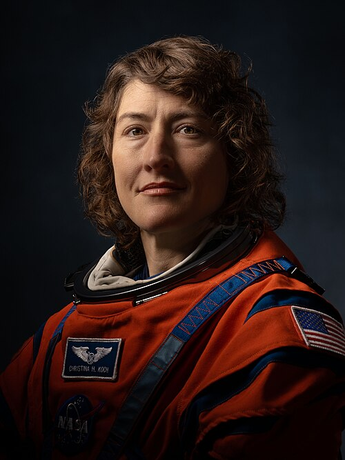
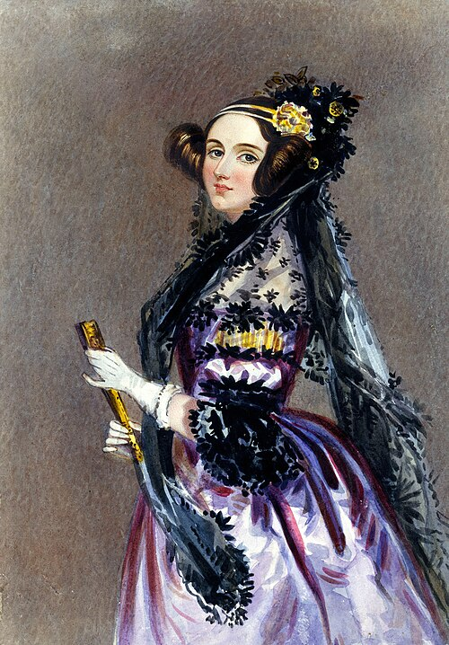

# Temas del curso
### 16/09 · Mis aficiones
Una de mis principales aficiones es el CrossFit, un deporte de fuerza y resistencia ideal para ayudarme a mantenerme en forma y a superarme cada día. 
También me gusta mucho leer, sobre todo en mis momentos libres, y escuchar música, ver películas o series en netflix.
Me encanta pasar tiempo con mis amigos y sobre todo con mi familia.
Creo que tener diferentes aficiones me ayuda a desconectar y a disfrutar de mi tiempo libre.
Además, me gusta salir a pasear y descubrir lugares nuevos cuando tengo tiempo y ganas.

Buscando en GitHub he encontrado, https://github.com/INK-USC/CrossFit, una programa para conocer un poco más sobre el CrossFit.

Esto es el CrossFit

### 28/09 · Premios Princesa de Asturias: CHRISTINA KOCH

 Fue una astronauta aventurera y física estadounidense. Se convirtió en la primer mujer en viajar a la Luna durante la misión Artemis II, donde también logró el record de mayor distancia recorrida por humanos en el espacio. Gracias a sus contribuciones espaciales en la NASA ganó el Premio de Princesa de Asturias de la Concordia 2026. He elegido a esta pionera del espacio porque ha sido un ejemplo a seguir de valentía para superar desafíos gracias al trabajo constante.

(https://www.fpa.es/es/premios-princesa-de-asturias/premiados/2026-christina-koch/)

Christina Koch

### 13/10 · Ada Lovelace

Ada Lovelace fue una mujer inglesa que nació en 1815 y a la que le gustaban mucho las matemáticas y la ciencia. Trabajó con Charles Babbage, que diseñó una máquina capaz de hacer cálculos. Ada escribió instrucciones para esa máquina y por eso se la considera la primera programadora de ordenadores de la historia. Su día se celebra para recordar su trabajo y destacar la importancia de las mujeres en la ciencia y la tecnología. El Día de Ada Lovelace se celebra el segundo martes de octubre.

[Ada Lovelace en Wikipedia](https://es.wikipedia.org/wiki/Ada_Lovelace)
[Ada Lovelace en mncn](https://www.mncn.csic.es/es/visita-el-mncn/biografia-de-ada-lovelace)

{: width="300"}

*PIE DE FOTO. Imagen: Alfred Edward Chalon,[ (https://commons.wikimedia.org/wiki/File:Ada_Lovelace_portrait.jpg)*

---

